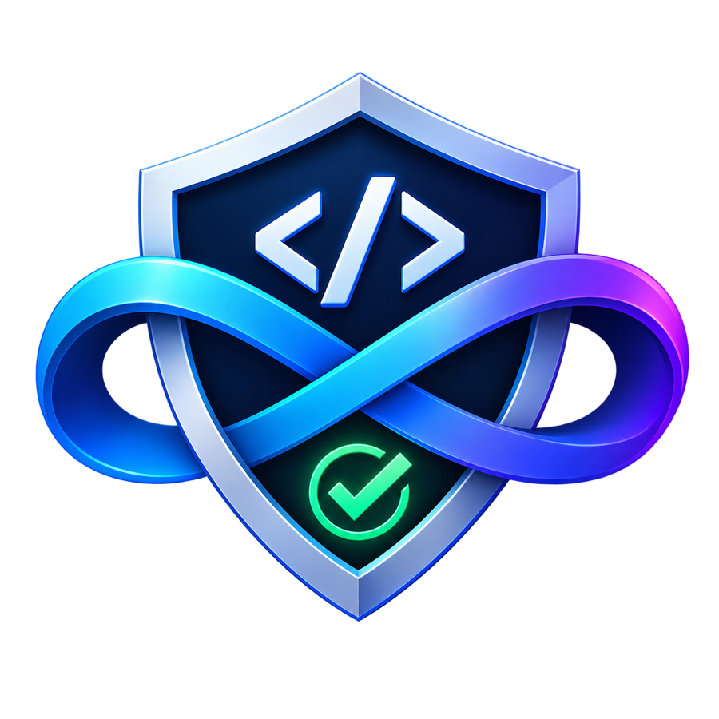

<div align="center">



# Evren Kod

**Zanaat disipliniyle kodlayan, kanıtla doğrulayan otonom VS Code ajanı.**

> **Zanaat:** Bilgi grafiğiyle mimariyi okur; hiçbir düzenlemeyi kanıtsız "başarılı" saymaz. · **Kalkan:** İzin kalkanı, dizin hapsi ve komut politikası — izin sizden alınmadan tek satır yazılmaz. · **Dürüstlük:** Yanlışını gizlemez: tekrarlayan yanıt kesilir, çıkmaz sokakta üçüncü denemede durur, "testler geçti" yalnızca testler gerçekten geçince söylenir.

[](./LICENSE)
[](https://marketplace.visualstudio.com/items?itemName=ysf-bkr.evren-kod)
[](https://code.visualstudio.com/)
[](https://www.typescriptlang.org/)
[](https://github.com/ysf-bkr/evren-kod/actions/workflows/ci.yml)
[](./docs/DEVELOPMENT.md)

**Geliştirici:** Yusuf BEKAR · **E-posta:** [ybekar@msn.com](mailto:ybekar@msn.com)

**[Marketplace'den Kur](https://marketplace.visualstudio.com/items?itemName=ysf-bkr.evren-kod)** · [GitHub Deposu](https://github.com/ysf-bkr/evren-kod) · [Hata Bildir / Özellik İste](https://github.com/ysf-bkr/evren-kod/issues) · [Geliştirici Kılavuzu](./docs/DEVELOPMENT.md)

</div>

> [!IMPORTANT]
> **Varsayılan Olarak Yerel ve Güvenli Çalışır**
>
> Evren Kod hiçbir bulut sağlayıcısına bağımlı değildir. **Varsayılan sağlayıcı Ollama'dır**: kurulum sonrasında herhangi bir API anahtarı gerekmeden, tamamen kendi makinenizde çevrimdışı çalışabilir. EVREN LLM, OpenRouter ve OpenAI uyumlu uç noktalar isteğe bağlı olarak yapılandırılabilir.

---

## Öne Çıkan Özellikler

| Özellik                                     | Açıklama                                                                                                                                                                                                                                                                                                                                                     |
| ------------------------------------------- | ------------------------------------------------------------------------------------------------------------------------------------------------------------------------------------------------------------------------------------------------------------------------------------------------------------------------------------------------------------ |
| **Otonom ReAct Döngüsü**                    | Hedefe ulaşana kadar dosyaları inceler, terminal komutları çalıştırır, testleri koşturur ve hataları otonom olarak düzeltir.                                                                                                                                                                                                                                 |
| **Kod Değişiklikleri ve İnceleme (Review)** | Yapılan tüm kod düzenlemeleri tur sonunda toplanır; tek tıkla VS Code Diff görünümünde incelenebilir ve gerektiğinde geri alınabilir.                                                                                                                                                                                                                        |
| **Yönlendirilmiş Geliştirme Akışı**         | Anlama → İstek → Spec Onayı → Modül Haritası ve Plan Onayı → Uygulama → İnceleme → Doğrulama aşamalarıyla kontrollü mühendislik.                                                                                                                                                                                                                             |
| **Eğitim Modu**                             | Yeni başlayanlara sohbette sabırla rehberlik: kod ve algoritmaları sade Türkçe analojilerle, sözde kod + adım adım örnek çizelgesiyle anlatma sözleşmesi; tipik hataları gösterir, alıştırma bırakır, dersi "Ne öğrendik?" özetiyle bitirir. Dosya yazma ve komut çalıştırma bu modda teknik olarak kilitlidir; anlatım kalitesi seçtiğiniz modele bağlıdır. |
| **Endüstriyel Modül Akışı**                 | Kod yazmadan önce iş, katmanlı modüllere ayrılır (shared → domain → infrastructure → application → interface); her modüle sahip uzman atanır ve modüller bağımlılık sırasıyla yazılır. Katman ihlalleri ve döngüler reddedilir.                                                                                                                              |
| **Geniş Model Desteği**                     | EVREN LLM (SSYZ), Yerel Ollama, LM Studio, OpenRouter ve tüm OpenAI API uyumlu modellerle tam uyum.                                                                                                                                                                                                                                                          |
| **Güvenli Sır Saklama**                     | API anahtarları işletim sisteminin güvenli anahtarlığında (`SecretStorage`) şifreli saklanır, arayüzde asla açık gösterilmez.                                                                                                                                                                                                                                |
| **Proje Hafızası ve Bilgi Tabanı**          | `.evren-kod/memory.md` ve `.evren-kod/knowledge/` ile projeninizin mimari kararlarını, kurallarını ve sembollerini hatırlar.                                                                                                                                                                                                                                 |
| **Geri Alma (Undo) ve Kontrol Noktaları**   | Her tur başında Git checkpoint'i alınır; istenmeyen değişiklikler tek tıkla eski haline döndürülür.                                                                                                                                                                                                                                                          |
| **EVREN Kotası ve Model Çubuğu**            | Sohbet altındaki çubuk, EVREN günlük token kotasını (kullanılan / sınır / kalan) canlı gösterir ve sohbetten ayrılmadan model değiştirmeyi sağlar.                                                                                                                                                                                                           |
| **Arka Planda Çalışan Sohbetler**           | Her sohbet kendi ajan çekirdeğinde çalışır: sohbet değiştirmek veya yeni sohbet açmak önceki görevi (ve alt ajanlarını) durdurmaz. Paylaşılan servisler sayesinde ikinci sohbet ucuzdur.                                                                                                                                                                     |
| **Türkçe Belgeler ve Türkçe Arayüz**        | Proje belgeleri, rehberler ve arayüzdeki tüm hata mesajları, bildirimler ve plan adımları eksiksiz Türkçe.                                                                                                                                                                                                                                                   |
| **Bilgi Grafiği (Knowledge Graph)**         | Çağrı haritası, dosya import'ları, sembol imzaları ve kayıtlı mimari kararlar tek grafında: ajan bir görev için projeyi baştan okumak yerine hazır bağıntıları okur; her çıktı sabit token bütçesiyle döner. Arayüzde "Bilgi Grafiği" ekranında gezilebilir.                                                                                                 |
| **Akıl Sağlığı Korumaları**                 | Model bir satıra kilitlenip aynı metni sonsuza dek tekrarladığında akış otomatik kesilir; aynı araç aynı argümanla üçüncü kez patlarsa tur duraklatılır. Uzun görevler sessizce kontrolden çıkamaz.                                                                                                                                                          |
| **Bağlam Penceresi Ayarı**                  | Modelinin bağlam pencereyi ayarlardan bildir; sohbet geçmişi ve araç çıktıları gerçek sınıra göre budanır, istekler taşmaz.                                                                                                                                                                                                                                  |
| **Terminal Arayüzü (`evren-kod`)**          | Aynı çekirdek terminalde: tek istemlik çalıştırma ya da `evren-kod` ile etkileşimli sohbet; onaylar, plan ve korumalar VS Code ile aynı.                                                                                                                                                                                                                     |

---

## İnsani Mühendislik: Ajan Sana Değil, Sen Ajana Hükmedersin

Evren Kod bir otonomluk şovu değil, zanaatkâr çırağı gibi tasarlandı: çalışır, sorar, yanlışı saklamaz.

- **Son söz her zaman senin.** Spec ve plan onayı, araç izinleri, tehlike sınıflandırması ve dizin hapsi olmadan tek satır değişmez; `manual` varsayılandır, otonomluk açıkça kuşanılır.
- **Yanlışı kendine saklamaz.** Tekrarlayan yanıt, takılan araç ve doğrulanmayan iddia kullanıcıdan gizlenmez: akış kesilir, tur duraklatılır, sebep Türkçe bildirilir.
- **Başarısızlığı süslemez.** Hiçbir şey değiştirmeyen düzenleme "başarılı" sayılmaz; "doğrulandı" yalnızca testler gerçekten koşunca denir; kanıtı olmayan bulgu rapor edilmez.
- **Biten iş sohbette kalır.** Tamamlanan görevin izi konuşmanın içinde okunabilir kalır; arayüz, bittiği hâlde ekranda takılı kalan göstergelerle gürültü üretmez.
- **Kaynağa saygı.** Sabit değerin üstünde iş yapmaz: adım, dakika ve token senin ayarladığın sınırların esiri değildir; bağlam penceresi modele göre gerçekten yapılandırılır.

---

## Hızlı Başlangıç

### 1. Kurulum

Uzantı **VS Code Marketplace**'te yayımda: [Evren Kod — ysf-bkr.evren-kod](https://marketplace.visualstudio.com/items?itemName=ysf-bkr.evren-kod)

```bash
# Marketplace'ten kurmak için:
code --install-extension ysf-bkr.evren-kod

# veya VS Code içinde Ctrl+Shift+P (Cmd+Shift+P) → "Extensions: Install Extensions"
# → arama kutusuna "Evren Kod" yazın.
```

Kaynaktan geliştirmek veya geliştirme sürümü kullanmak isterseniz yerel VSIX
paketini (`out/evren-kod-0.1.1.vsix`) derleyip kurabilirsiniz:

```bash
# Otomatik derleme, paketleme ve kurulum için:
npm run install:ext

# veya üretilen VSIX paketini doğrudan kurmak için:
code --install-extension out/evren-kod-0.1.1.vsix --force
```

### 2. Model Sağlayıcınızı Seçin

VS Code ikincil kenar çubuğundaki (secondary sidebar) **Evren Kod** simgesine tıklayın veya `Ctrl+Shift+P` (`Cmd+Shift+P`) ile `Evren Kod: Sohbeti Aç` komutunu çalıştırın.

- **Yerel Ollama (Önerilen yerel seçenek):** Ollama çalışıyorsa hiçbir ek ayar yapmadan doğrudan sohbete başlayabilirsiniz.
- **EVREN LLM (SSYZ):** Ayarlar ekranından sağlayıcıyı EVREN seçip API anahtarınızı girin.
- **OpenRouter / OpenAI Uyumlu:** İlgili sağlayıcıyı seçip anahtarınızı kaydedin.

### 3. Göreve Başlayın

Evren Kod giriş alanına görevinizi yazın:

- _"Projede derleme ve tip hatalarını bulup düzelt."_
- _"Auth servisi için birim testleri yaz ve çalıştır."_
- _"Kod tabanını güvenlik ve performans açısından incele."_

---

## Modlar: Kodlama, Planlama ve Eğitim

Evren Kod üç çalışma moduna sahiptir:

1. **Kodlama Modu (`code`):** Dosya oluşturma, düzenleme ve terminal komutlarını çalıştırma yetkisine sahiptir. Projenizi aktif olarak geliştirir.
2. **Planlama Modu (`plan`):** Dosya yazma ve komut çalıştırma araçları teknik olarak kilitlidir. Yalnızca okuma, arama ve mimari analiz yaparak kapsamlı yol haritaları hazırlar.
3. **Eğitim Modu (`education`):** Yeni başlayanlara sohbette sabırla rehberlik eder. Dosya yazma ve komut çalıştırma teknik olarak kilitlidir; sistem istemi modele ders biçimi sözleşmesi dayatır: kavramlar sade Türkçe analojilerle, algoritmalar sözde kod + adım adım örnek çizelgesiyle anlatılır. Dersler sohbette kopyalanabilir küçük kod blokları, tipik hataların açıklaması ve "Ne öğrendik?" özetiyle biter; alıştırmalar size bırakılır. Anlatımın zekâsı seçtiğiniz modele, kilitler ve ders biçimi ise güvence altında olan taraf biziz. Dilerseniz öğrendiğinizi Kodlama modunda birlikte uygularsınız.

---

## Sohbet ve İnceleme (Review) Deneyimi

Evren Kod arayüzü, modern kodlama ajanlarının en iyi pratiklerini bir araya getirir:

- **Kod Değişiklikleri Paneli:** Asistanın bir turda oluşturduğu veya değiştirdiği tüm dosyalar bir kartta toplanır.
- **Tek Tıkla Diff:** Değiştirilen satırları incelemek için **İncele (Diff)** butonuna tıklamanız yeterlidir.
- **Adım Bazlı Geri Alma:** Herhangi bir dosyadaki değişikliği **Geri Al** butonuyla iptal edebilirsiniz.
- **Görev Planı İlerlemesi:** Görev adımları durum çubuğunda canlı olarak takip edilir (`%25`, `%50`, `%100`).

---

## Temel Ayarlar

Aşağıdaki ayarları VS Code Ayarlarından (`settings.json`) veya Evren Kod arayüzündeki Ayarlar ekranından yapılandırabilirsiniz:

| Ayar                         | Varsayılan | Açıklama                                                                                                                                                                              |
| ---------------------------- | ---------- | ------------------------------------------------------------------------------------------------------------------------------------------------------------------------------------- |
| `evren-kod.selectedProvider` | `ollama`   | Model sağlayıcısı (`ollama`, `evren`, `openrouter`, `openai-compatible`)                                                                                                              |
| `evren-kod.selectedModel`    | `llama3.1` | Kullanılacak model adı                                                                                                                                                                |
| `evren-kod.autonomy`         | `manual`   | Otonomi seviyesi (`manual`, `guided`, `auto`); sohbet giriş alanından da değiştirilebilir                                                                                             |
| `evren-kod.agentModels`      | `{}`       | Rol bazlı alt ajan modelleri (rol → model kimliği). Boş roller sağlayıcının hazır ayarını (EVREN: manager/architect → glm-5.3, explorer → mimo-v2.6-pro) ya da seçili modeli kullanır |
| `evren-kod.embeddingBaseUrl` | `""`       | OpenAI uyumlu embedding uç noktası (örn. EVREN `/v1`). Boşsa Ollama `/api/embed` kullanılır                                                                                           |

---

## Mimari ve Geliştirici Kılavuzu

Evren Kod'un iç yapısı, modül katmanları, test çalıştırma ve katkı sağlama yönergeleri ayrı belgelere ayrılmıştır:

- **[Geliştirici Kılavuzu (docs/DEVELOPMENT.md)](./docs/DEVELOPMENT.md):** Kaynaktan derleme, test çalıştırma, tasarım sistemi değişkenleri, MCP entegrasyonu ve katkı kuralları.
- **[Mimari Dokümantasyonu (docs/ARCHITECTURE.md)](./docs/ARCHITECTURE.md):** Çekirdek ReAct döngüsü, araç zinciri, denetim katmanı ve LSP detayları.
- **[Gizlilik Bildirimi (docs/PRIVACY.md)](./docs/PRIVACY.md):** Veri güvenliği, yerel model ilkeleri ve telemetri politikası.

---

## Bilinen Sınırlamalar

- **Komut geri alma temiz Git ağacı ister:** `execute_command` bir Git checkpoint'i alır ve geri alınabilir; ancak bu yalnızca depoda bir `HEAD` varsa ve komut öncesi çalışma ağacı temizse çalışır. Git deposu olmayan alanlarda komut yan etkileri geri alınamaz; bu durumlar için Git'i kendiniz kullanın.
- **Plan modu sandbox değil, araç kilididir:** plan modu yazma ve komut araçlarını şemadan çıkarır, ancak işletim sistemi düzeyinde yalıtım sağlamaz. Güvenilmeyen depolar için Dev Container kullanın.

---

## Lisans ve Destek

Bu proje [MIT Lisansı](./LICENSE) kapsamında açık kaynak olarak geliştirilmektedir.

Katkılar memnuniyetle karşılanır: [CONTRIBUTING.md](./CONTRIBUTING.md) ve
[Davranış Kuralları](./CODE_OF_CONDUCT.md) belgelerine bakın. Güvenlik
sorunlarını [SECURITY.md](./SECURITY.md) uyarınca özel kanaldan bildirin.

Sorularınız, hata bildirimleriniz ve özellik önerileriniz için [GitHub Issues](https://github.com/ysf-bkr/evren-kod/issues) sayfasını kullanabilir veya [ybekar@msn.com](mailto:ybekar@msn.com) adresinden iletişime geçebilirsiniz.
