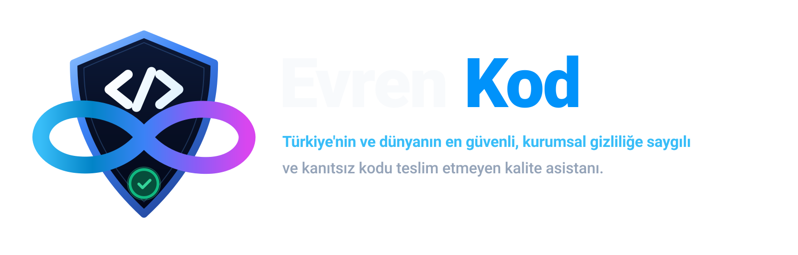

# Evren Kod: Kapsamlı Özellik, Mimari ve Yetenek Rehberi

  

Bu belge, Evren Kod ekosisteminin tüm bileşenlerini, ajan mimarisini, araç entegrasyonlarını, güvenlik mekanizmalarını, iş akışlarını ve sistemler arası karşılıklı ilişkilerini hiçbir kod parçasına yer vermeksizin, saf kavramsal, yapısal ve işlevsel ilişkileriyle en ince detayına kadar açıklamaktadır.

---

## 1. Mimarinin Temel Felsefesi ve Katmanlar Arası İlişkiler

Evren Kod; insan mühendisliği titizliğini, bilimsel yazılım geliştirme disiplinini ve kesin ispatlara dayalı kalite güvencesini merkeze alan çok katmanlı bir yapay zekâ yazılım geliştirme platformudur.

Sistem, birbirine gevşek bağlı fakat sözleşmelerle sıkı sıkıya kenetlenmiş dört ana katmandan oluşur:

1. **Çekirdek Motor Katmanı (`@evren-kod/core`):** Editörden ve arayüzlerden tamamen bağımsız, iş mantığının, ajanların, izinlerin, araçların, bilgi grafiğinin ve hafızanın yaşadığı merkezdir.
2. **VS Code Eklenti Köprüsü (`src/`):** Çekirdek motor ile Visual Studio Code editör API'leri, dil sunucuları (LSP), yerel bildirimler ve dosya sistemi arasında köprü kuran konak katmandır.
3. **Kullanıcı Arayüzü (`webview-ui/`):** Geliştirici ile ajan arasındaki tüm etkileşimi, görsel diff incelemelerini, çağrı haritalarını, raporları ve onay kartlarını yöneten modern ön yüz katmanıdır.
4. **Bağımsız Terminal İstemcisi (`evren-kod` CLI):** VS Code kurulu olmayan sunucularda, CI/CD ortamlarında veya doğrudan komut satırında tam yetenekli ReAct döngüsünü çalıştıran başsız (headless) çalıştırma arayüzüdür.

Bu katmanlar arasındaki veri akışı asenkron mesajlaşma, tiple kilitlenmiş sözleşmeler ve olay tabanlı durum yönetimiyle yürütülür.

---

## 2. Çoklu Ajan (Multi-Agent) Sistemi ve Rol Hiyerarşisi

Evren Kod, karmaşık bir geliştirme görevini tek bir monolitik modele emanet etmek yerine, uzmanlaşmış alt ajanların iş birliği yaptığı orkestre edilmiş bir ekip modeli uygular. Toplamda **13 Şemsiye Rol** ve bu rollerin altına yerleşen **89 Katalog Uzmanı** ile 102 farklı uzmanlık alanı tanımlıdır.

### A. 13 Şemsiye Rol (Ana Koordinatörler)

- **`manager` (Yönetici / Master Orchestrator):** Büyük ve çok adımlı görevleri analiz eder, gereksinimleri bağımsız iş birimlerine ayırır, alt ajanları görevlendirir ve paralel çalışma kollarını denetler.
- **`analyst` (Gereksinim Analisti):** Kullanıcının doğal dildeki talebini netleştirir; eksik, muğlak veya çelişkili noktaları tespit etmek için soru sorma bütçesini (`intake`) yönetir.
- **`architect` (Yazılım Mimarı):** Sistem bileşenlerini, katmanlar arası sınırları, veri akış şemalarını ve modül bağımlılıklarını belirler.
- **`backend` (Sunucu Uzmanı):** API uç noktalarını, iş kurallarını, veri erişim katmanlarını ve mikroservis iletişimini tasarlar ve yazar.
- **`frontend` (Önyüz Uzmanı):** Kullanıcı arayüzlerini, bileşen hiyerarşisini, reaktif durum yönetimini ve ekran erişilebilirliğini üstlenir.
- **`mobile` (Mobil Uzmanı):** Mobil cihaz kısıtlarını, dokunmatik ergonomiyi, platforma özgü izinleri ve yerel köprüleri yönetir.
- **`native` (Masaüstü ve Sistem Uzmanı):** Düşük seviyeli bellek yönetimini, işletim sistemi çağrılarını, donanım kaynaklarını ve yerel ikili paketleri yönetir.
- **`database` (Veritabanı Mühendisi):** İlişkisel ve ilişkisel olmayan veri modellerini, indeksleme stratejilerini, şema göçlerini ve veri bütünlüğü kurallarını kurgular.
- **`devops` (Altyapı ve DevOps Uzmanı):** Konteynerleştirme, kümeleme, sürekli entegrasyon/dağıtım boru hatları ve bulut kaynaklarını yönetir.
- **`explorer` (Kod Gezgini):** Kod tabanında derinlemesine keşif yapar; bilinmeyen fonksiyonları, referansları ve dosya ağaçlarını haritalandırır.
- **`git` (Sürüm Kontrol Uzmanı):** Git geçmişini analiz eder; temiz dallanma stratejileri, atomik commit planları ve çekme istekleri (PR) hazırlar.
- **`quality` (Kalite ve Test Güvencesi Uzmanı):** Birim testlerinden sistem kabul testlerine kadar tüm doğrulama senaryolarını kurar ve kod kalitesini ölçer.
- **`security` (Güvenlik ve Uyumluluk Uzmanı):** Güvenlik açıklarını, enjeksiyon risklerini, hassas veri sızıntılarını ve açık kaynak lisans uyumluluklarını denetler.

### B. 12 Kategoride 89 Katalog Uzmanı

1. **Yönetim ve Analiz (5 Uzman):**
   - `product-manager` (Ürün Yöneticisi) — Ürün hedefleri, önceliklendirme ve değer tespiti.
   - `business-analyst` (İş Analisti) — Numaralandırılmış iş gereksinimleri ve paydaş analizi.
   - `project-manager` (Proje Yöneticisi) — Görev sıralaması, bağımlılıklar ve kritik yol planı.
   - `technical-researcher` (Teknik Araştırmacı) — Kütüphane, lisans ve teknoloji araştırması.
   - `documentation-writer` (Dokümantasyon Uzmanı) — README, kılavuzlar ve karar kayıtları (ADR).
2. **Mimari ve Tasarım (6 Uzman):**
   - `solution-architect` (Çözüm Mimarı) — Uçtan uca sistem tasarımı ve teknoloji seçimi.
   - `system-architect` (Sistem Mimarı) — Dağıtık sistemler, ölçeklenebilirlik ve modülerlik.
   - `database-architect` (Veritabanı Mimarı) — Veri modelleme, normalizasyon ve şema mimarisi.
   - `api-architect` (API Mimarı) — REST, GraphQL, gRPC arayüz sözleşmeleri.
   - `uiux-designer` (UI/UX Tasarımcısı) — Kullanıcı deneyimi, etkileşim akışı ve wireframe.
   - `design-system` (Tasarım Sistemi Uzmanı) — Token'lar, tema ve yeniden kullanılabilir UI kütüphaneleri.
3. **Önyüz Geliştirme (6 Uzman):**
   - `react-developer` (React / Next.js Geliştiricisi) — React ekosistemi, hooks ve SSR.
   - `vue-developer` (Vue / Nuxt Geliştiricisi) — Vue 3, Composition API ve Nuxt.
   - `angular-developer` (Angular Geliştiricisi) — Angular bileşenleri, RxJS ve servisler.
   - `css-specialist` (CSS / Arayüz Uzmanı) — Tailwind, responsive tasarım ve animasyonlar.
   - `accessibility` (Erişilebilirlik Uzmanı) — WCAG 2.1 AA uyumu, ARIA ve ekran okuyucu desteği.
   - `frontend-performance` (Frontend Performans Uzmanı) — Core Web Vitals, bundle boyutu ve lazy loading.
4. **Sunucu Geliştirme (8 Uzman):**
   - `nodejs-developer` (Node.js Geliştiricisi) — Express, Fastify, NestJS ve asenkron I/O.
   - `python-developer` (Python Geliştiricisi) — FastAPI, Django, Flask ve veri işleme.
   - `dotnet-developer` (.NET Geliştiricisi) — C#, ASP.NET Core ve kurumsal servisler.
   - `java-developer` (Java Geliştiricisi) — Spring Boot, kurumsal mikroservisler ve JVM.
   - `php-developer` (PHP Geliştiricisi) — Laravel, Symfony ve modern PHP standartları.
   - `go-developer` (Go Geliştiricisi) — Yüksek eşzamanlılık, goroutine'ler ve mikroservisler.
   - `api-developer` (API Geliştiricisi) — Uç nokta mantığı, doğrulama ve middleware.
   - `integration` (Entegrasyon Uzmanı) — Üçüncü parti webhook ve harici API köprüleri.
5. **Veritabanı ve Veri Mühendisliği (5 Uzman):**
   - `sql-specialist` (SQL Uzmanı) — PostgreSQL, MySQL sorguları ve indeks tasarımı.
   - `nosql-specialist` (NoSQL Uzmanı) — MongoDB, Redis, doküman ve anahtar-değer depoları.
   - `migration-engineer` (Migration Uzmanı) — Geri alınabilir şema göçleri ve veri transferi.
   - `data-engineer` (Veri Mühendisi) — ETL boru hatları, veri analitiği ve akış işleme.
   - `cache-specialist` (Cache Uzmanı) — Redis/Memcached önbellekleme stratejileri.
6. **Mobil Geliştirme (7 Uzman):**
   - `android-developer` (Android Geliştiricisi) — Kotlin, Jetpack Compose ve Android SDK.
   - `ios-developer` (iOS Geliştiricisi) — Swift, SwiftUI ve Apple ekosistemi.
   - `flutter-developer` (Flutter Geliştiricisi) — Dart, Flutter widget'ları ve çapraz mobil.
   - `react-native-developer` (React Native Geliştiricisi) — Expo, native köprüler ve mobil UI.
   - `mobile-uiux` (Mobil Arayüz Tasarımcısı) — Dokunmatik etkileşimler ve mobil ergonomi.
   - `mobile-tester` (Mobil Test Uzmanı) — Cihaz emülatörleri, Appium ve mobil UI testleri.
   - `mobile-release` (Mobil Yayınlama Uzmanı) — App Store, Google Play ve fastlane süreçleri.
7. **Masaüstü ve Sistem (8 Uzman):**
   - `windows-developer` (Windows Geliştiricisi) — WinUI, WPF ve Windows API entegrasyonu.
   - `linux-developer` (Linux Geliştiricisi) — POSIX, systemd, GTK ve Linux çekirdek araçları.
   - `macos-developer` (macOS Geliştiricisi) — AppKit, macOS sandbox ve yerel araçlar.
   - `electron-developer` (Electron Geliştiricisi) — IPC iletişimi, ana ve renderer süreçleri.
   - `tauri-developer` (Tauri Geliştiricisi) — Rust arka uç ve hafif web arayüzü.
   - `qt-developer` (Qt / C++ Geliştiricisi) — QML, Qt Core ve platform bağımsız C++.
   - `cross-platform` (Çapraz Platform Uzmanı) — Çoklu platform derleme ve uyumluluk.
   - `packaging` (Paketleme Uzmanı) — MSIX, DMG, AppImage, DEB, RPM ve yükleyiciler.
8. **Kalite ve Test Güvencesi (10 Uzman):**
   - `unit-test` (Birim Test Uzmanı) — Mock, stub, assertion ve yüksek test kapsamı.
   - `integration-test` (Entegrasyon Test Uzmanı) — Servisler ve veri tabanı arası akış testleri.
   - `e2e-test` (Uçtan Uca Test Uzmanı) — Playwright, Cypress ve kullanıcı senaryoları.
   - `ui-test` (Arayüz Test Uzmanı) — Görsel regresyon ve bileşen render testleri.
   - `api-test` (API Test Uzmanı) — Postman, contract testing ve yük testleri.
   - `performance-test` (Performans Test Uzmanı) — Benchmark, bellek sızıntısı ve gecikme analizi.
   - `regression-test` (Regresyon Test Uzmanı) — Eski işlevlerin bozulmadığını kanıtlama.
   - `bug-hunter` (Hata Avcısı) — Sınır durumlar, off-by-one ve çökmelerin tespiti.
   - `code-review` (Kod İnceleme Uzmanı) — Clean code, SOLID prensipleri ve okunabilirlik.
   - `release-gate` (Yayın Kapısı Uzmanı) — Test, lint ve kapsama kanıtı onay mekanizması.
9. **Güvenlik ve Uyum (7 Uzman):**
   - `app-security` (Uygulama Güvenliği Uzmanı) — OWASP Top 10, XSS, CSRF, enjeksiyon önleme.
   - `api-security` (API Güvenliği Uzmanı) — OAuth2, JWT, rate limit ve yetkilendirme.
   - `infra-security` (Altyapı Güvenliği Uzmanı) — SSH, TLS sertifikaları ve sunucu sıkılaştırma.
   - `dependency-audit` (Bağımlılık Denetçisi) — CVE, npm audit ve virütik paket tespiti.
   - `pentest` (Sızma Testi Uzmanı) — Zafiyet taraması ve güvenlik sınır testleri.
   - `privacy-compliance` (Gizlilik Uyum Uzmanı) — KVKK, GDPR ve veri saklama kuralları.
   - `auth-specialist` (Kimlik Doğrulama Uzmanı) — SSO, MFA ve kimlik sağlayıcı entegrasyonu.
10. **DevOps ve Bulut (10 Uzman):**
    - `docker-specialist` (Docker Uzmanı) — Multi-stage builds, minimal imajlar ve güvenlik.
    - `kubernetes-specialist` (Kubernetes Uzmanı) — Pod'lar, ingress, helm charts ve servisler.
    - `cloud-architect` (Bulut Mimarı) — AWS, GCP, Azure bulut mimarisi.
    - `linux-server` (Linux Sunucu Mühendisi) — Nginx, systemd, güvenlik duvarı ve optimizasyon.
    - `windows-server` (Windows Sunucu Mühendisi) — IIS, PowerShell ve servis yönetimi.
    - `cicd-engineer` (CI/CD Mühendisi) — GitHub Actions, GitLab CI ve otomatik dağıtım.
    - `iac-engineer` (Altyapı Kodlama Uzmanı) — Terraform, Ansible ve bulut otomasyonu.
    - `monitoring` (İzleme Uzmanı) — Prometheus, Grafana, OpenTelemetry ve APM.
    - `backup-recovery` (Yedekleme ve Kurtarma) — Felaket kurtarma (DR) ve yedekleme stratejileri.
    - `network-engineer` (Ağ Mühendisi) — DNS, VPN, TCP/IP ve ağ yönlendirmeleri.
11. **Yapay Zekâ ve Veri (11 Uzman):**
    - `ai-architect` (AI Sistem Mimarı) — LLM orkestrasyonu ve model seçim stratejileri.
    - `llm-developer` (LLM Geliştiricisi) — Prompt engineering, fine-tuning ve context yönetimi.
    - `rag-specialist` (RAG Uzmanı) — Vektör veri tabanları, embedding ve semantik arama.
    - `ai-agent-developer` (AI Agent Geliştiricisi) — ReAct döngüleri, tool-use ve hafıza.
    - `mcp-specialist` (MCP Uzmanı) — Model Context Protocol sunucu ve istemci köprüleri.
    - `ml-engineer` (Makine Öğrenmesi Mühendisi) — Scikit-learn, PyTorch model eğitimi.
    - `computer-vision` (Görüntü İşleme Uzmanı) — OpenCV, OCR ve nesne algılama.
    - `speech-ai` (Ses ve Konuşma Uzmanı) — Whisper, STT/TTS entegrasyonları.
    - `ai-evaluation` (AI Değerlendirme Uzmanı) — Model çıktılarının doğruluk ve halüsinasyon testi.
    - `ai-safety` (AI Güvenlik Sınırı Uzmanı) — Jailbreak engelleme ve prompt injection savunması.
    - `automation-engineer` (Otomasyon Mühendisi) — Robotik süreç otomasyonu ve betikler.
12. **Operasyon ve Bakım (6 Uzman):**
    - `deployment` (Dağıtım Uzmanı) — Blue/green ve canary sıfır-kesinti dağıtımları.
    - `product-acceptance` (Ürün Kabul Uzmanı) — Kabul kriterleri karşılama kontrolü.
    - `technical-writer` (Teknik Yazar) — Kullanıcı kılavuzları ve API dokümantasyonu.
    - `support` (Destek Uzmanı) — Log analizi, hata ayıklama ve kullanıcı sorun çözümü.
    - `maintenance` (Bakım Uzmanı) — Kütüphane güncellemeleri ve teknik borç temizliği.
    - `performance-optimizer` (Sistem Optimizasyon Uzmanı) — CPU/RAM darboğaz analizi.

### C. Ajanlar Arası İletişim ve İzolasyon Altyapısı

- **Görev Devri (`invoke_subagent`):** Ana ajan, görevin kapsamına giren uzmanlık alanını tespit eder ve işi ilgili alt ajana devreder.
- **Dinamik Ekip Seçimi (`selectActiveTeam`):** Çalışma alanının dili, çatısı ve mimarisi otomatik taranarak göreve en uygun uzmanlardan oluşan bir çekirdek ekip oluşturulur.
- **İzole Çalışma Ağaçları (`run_parallel_tasks`):** Çoklu ajanlar paralel çalışırken ana çalışma alanını bozmamak için geçici, yalıtılmış Git dallarında işlem yapar.
- **Dalların Birleştirilmesi (`merge_worktree`):** Alt ajanın ürettiği çözümler doğrulama testlerinden geçtikten sonra kullanıcı onayıyla ana dala aktarılır.

---

## 3. Otonomi Seviyeleri ve İnsan Denetimi

Evren Kod, geliştiricinin kontrol arzusu ile ajanın hız ihtiyacı arasındaki dengeyi üç kademeli bir otonomi politikasıyla kurar:

1. **Elle Yönetim (`manual`):**
   - En sıkı kontrol modudur.
   - Şartname onayı, modül planı onayı, dosya oluşturma/düzenleme ve her terminal komutu için kullanıcı arayüzünde açık onay kartı açılır.
   - Kullanıcı butona basıp izin vermedikçe hiçbir eylem icra edilemez.
2. **Yarı Otonom (`guided`):**
   - Rutin, güvenli ve geri alınabilir işlemleri (okuma, bilinen güvenli komutlar, olağan dosya düzenlemeleri) kullanıcıyı boğmadan otomatik yürütür.
   - Mimari kararlarda, riskli komutlarda veya şartname onaylarında duraklayarak insan onayına başvurur.
3. **Tam Otonom (`auto`):**
   - Verilen görevi baştan sona kendi kendine tamamlamayı taahhüt eder.
   - Tur sonu duraklamalarını otomatik devam ettirir; sonsuz döngüleri engellemek amacıyla ardışık devam sayısını belirli bir tavanla (en fazla 12 tur) sınırlar.
   - **Güvenlik Sözleşmesi:** Otonomi seviyesi ne olursa olsun; yıkıcı komutlar, sistem dışına sızma girişimleri ve hassas kimlik dosyaları her koşulda açık insan onayı gerektirir.

---

## 4. Yönlendirilmiş İş Akışı Modları (Workflow State Machines)

Evren Kod, kullanıcının niyetine göre davranışını ve izinlerini biçimlendiren farklı çalışma modlarına sahiptir:

- **Kodlama Modu (`code` - 8 Kademeli Disiplinli Akış):**
  1. _Keşif (`onboard`):_ Çalışma alanı taranır, teknoloji yığını ve kurallar anlaşılır.
  2. _Gereksinim (`intake`):_ Kullanıcıyla netleştirme yapılır; soru bütçesi dahilinde belirsizlikler giderilir.
  3. _Şartname (`spec`):_ Kapsam, hedefler ve doğrulanabilir kabul kriterleri yazılır; onay kapısı açılır.
  4. _Modül Haritası (`module_plan`):_ Sistem katmanlara ve bağımlılık sırasına bölünür.
  5. _Plan (`plan`):_ Somut eylem adımları çıkarılır.
  6. _İnşa (`build`):_ Kod yazılır, akıllı diff uygulanır.
  7. _Gözden Geçirme (`review`):_ Değişiklik defteri denetlenir, statik analiz yapılır.
  8. _Doğrulama ve Kapanış (`verify` & `done`):_ Testler ve linter çalıştırılır; tüm kriterler kanıtlandığında yayın kapısı açılarak görev tamamlanır.
- **Hızlı Düzeltme Modu (`fast`):**
  - Küçük hatalar, ufak refaktörler ve tek atımlık istekler için bürokrasiyi kaldırır.
  - Şartname ve plan onaylarını atlayarak doğrudan inşa ve makine doğrulaması aşamalarına geçer: `onboard` $\rightarrow$ `build` $\rightarrow$ `verify` $\rightarrow$ `done`.
- **Planlama ve Mimari Modları (`plan` / `architect` / `ask`):**
  - Salt-okunur modlardır. Kod yazma ve terminal komutu çalıştırma araçları tamamen kilitlenir.
  - Yalnızca kod tabanını inceleme, etki analizi çıkarma, tasarım önerisi sunma ve stratejik yol haritası çizme amacıyla çalışır.
- **Öğrenme ve Beceri Modu (`learn`):**
  - Projenin kurallarını, mimari kararlarını ve rehber becerilerini hafızaya işlemek için kullanılır.

---

## 5. Bütünleşik Araç Cephanesi (51 Araçlık Tam Liste)

Evren Kod motoru, LLM'in dış dünyayla güvenli ve biçimli iletişim kurabilmesi için eksiksiz tanımlanmış 51 araçlık bir takıma sahiptir:

### A. Dosya ve Düzenleme Araçları

1. `read_file`: Belirtilen dosyanın içeriğini satır aralığı desteğiyle okur.
2. `write_file`: Yeni bir dosya oluşturur veya mevcut dosyayı baştan yazar.
3. `edit_file`: Hızlı ve toleranslı FastApply motoruyla SEARCH/REPLACE bloklarını veya unified diff yamalarını uygular.
4. `list_directory`: Belirtilen dizindeki dosya ve alt klasörleri listeler.
5. `search_files`: Proje genelinde metin veya düzenli ifade (RegEx) araması yapar.
6. `undo_change`: En son yapılan dosya mutasyonunu tek hamlede bayt bayt geri alır.
7. `read_notebook`: Jupyter (.ipynb) defter hücrelerini ve çıktılarını okur.

### B. Kabuk ve Otomatik Doğrulama Araçları

8. `execute_command`: Güvenlik filtresinden geçmiş terminal komutlarını çalıştırır.
9. `run_tests`: Projenin test komutunu otomatik tespit edip çalıştırır.
10. `run_linter`: Projenin linter ve statik tip denetim araçlarını çalıştırır.
11. `run_verification`: Bütünsel doğrulama paketini (test + lint + build) koşturur ve hata raporlar.

### C. Sürüm Kontrolü (Git) Araçları

12. `git_status`: Değiştirilen, silinen ve henüz takip edilmeyen dosyaların durumunu raporlar.
13. `git_diff`: Token tasarruflu ve akıllı Git diff çıktısı üretir.
14. `git_create_branch`: Kullanıcı onayıyla yeni bir Git geliştirme dalı açar.
15. `git_commit`: Yapılan değişiklikleri doğrulanmış inceleme kanıtıyla atomik olarak commit eder.
16. `prepare_pr`: Dal değişikliklerinden, commit'lerden ve şartnameden profesyonel PR metni üretir.
17. `merge_worktree`: İzole çalışma ağacını (worktree) ana çalışma alanına uygular ve birleştirir.

### D. Dil Sunucusu (LSP) ve Kod Zekâsı Araçları

18. `get_diagnostics`: Derleyici, linter ve tip hatalarını (tanıları) gerçek zamanlı okur.
19. `get_definition`: Bir fonksiyon, sınıf veya değişkenin kaynak tanımına doğrudan gider.
20. `get_hover`: İmleç altındaki sembolün tip imzasını ve dokümantasyonunu getirir.
21. `get_references`: Bir sembolün tüm kod tabanındaki referanslarını ve kullanım yerlerini listeler.
22. `get_workspace_symbols`: Çalışma alanı genelindeki sembolleri arar.

### E. Bilgi Grafiği ve Anlamsal Analiz Araçları

23. `knowledge_graph`: Çağrı ilişkileri, dosya importları ve sembol imzalarını içeren birleşik bilgi grafiğini sunar.
24. `graph_callers`: Bir sembolü çağıran fonksiyonları dosya bazında gruplayarak listeler.
25. `graph_callees`: Bir sembolün çağırdığı fonksiyonları dosya bazında listeler.
26. `graph_impact`: Bir veya daha fazla sembol değiştiğinde etkilenecek patlama yarıçapını (blast radius) hesaplar.
27. `graph_search`: Bilgi grafiğinde anahtar kelimeyle sembol ve dosya arar.
28. `graph_status`: Bilgi grafiğinin ve çağrı tarayıcısının hazır olma durumunu raporlar.
29. `index_workspace`: Çalışma alanındaki dosya, sembol, dışa/içe aktarım indeksini baştan inşa eder.
30. `find_symbol`: Proje bilgi tabanında belirli bir sembolü arar ve dosya:satır konumunu döner.
31. `analyze_impact`: Bir sembolün tanımlandığı ve bağımlı olabileceği dosyaları analiz eder.

### F. Şartname, Plan ve Yönetim Araçları

32. `write_spec`: Görevin hedefini, kapsamını, varsayımlarını ve kabul kriterlerini içeren şartname oluşturur/günceller.
33. `update_acceptance_criteria`: İş tamamlandıkça şartnamedeki kabul kriterlerini kanıtlarıyla işaretler.
34. `update_plan`: Onaylanmış modül haritasını bağımlılıkları ve durumları olan somut adımlara böler.
35. `update_module_plan`: Koda başlamadan önce projeyi katmanlı modüllere ayırır.
36. `record_release_gate`: Geçerli şartname için nihai yayın kapısı kararını ve test kanıtlarını mühürler.

### G. Bellek, Beceri ve Web Araçları

37. `search_memory`: Geçmiş görev hafızasında ve mimari kararlarda arama yapar.
38. `get_project_knowledge`: İndekslenmiş sembol sayılarını, kuralları ve proje bilgilerini getirir.
39. `add_knowledge_note`: Bilgi tabanına kalıcı bir mimari not ekler.
40. `write_knowledge_file`: Küratörlü bilgi dosyalarının (`project.md`, `conventions.md`) içeriğini önerir.
41. `read_skill`: `.agents/skills` altındaki Markdown formatındaki beceri kılavuzunu okur.
42. `web_fetch`: Güvenli HTTP/HTTPS sayfalarının metin içeriğini getirir (yerel/özel ağlar engellidir).
43. `web_search`: Tavily/Brave veya yerel arama motorları üzerinden web araması yapar.

### H. Çoklu Ajan ve Orkestrasyon Araçları

44. `invoke_subagent`: Odaklanmış bir iş birimini uzman bir alt ajana devreder.
45. `run_parallel_tasks`: Birden fazla alt ajan görevini izole Git worktree'lerinde eşzamanlı çalıştırır.
46. `ask_followup_question`: Kullanıcıya açıklayıcı ve netleştirici soru yöneltir.

### I. Geriye Dönük Uyumluluk Çağrı Haritası Takma Adları (Aliases)

47. `get_callers`: `graph_callers` aracının eski adı.
48. `get_callees`: `graph_callees` aracının eski adı.
49. `call_graph_impact`: `graph_impact` aracının eski adı.
50. `find_related_code`: `graph_search` aracının eski adı.
51. `call_graph_status`: `graph_status` aracının eski adı.

---

## 6. Kod Anlama, Sembol İndeksi ve Bağlam Optimizasyonu

Büyük projelerde LLM bağlam sınırının dolmasını ve yüksek maliyetleri önlemek amacıyla çok katmanlı bir anlama ve sıkıştırma mekanizması devreye girer:

- **AST İskeletleme (Skeletonization - `TokenOptimizationEngine`):**
  - 200 satırdan uzun dosyalarda fonksiyon ve sınıf gövdeleri atılır; yalnızca tipler, arayüzler ve fonksiyon imzaları tutularak bir iskelet çıkarılır.
  - Böylece model dosyanın genel mimarisini %70 daha az token harcayarak kavrar; gövdeye yalnızca düzenleme yapacağı zaman odaklanır.
- **Anlamsal Sembol İndeksi (`SemanticCodeIndex`):**
  - Projedeki tüm fonksiyon, sınıf, arayüz ve değişkenleri adları, tipleri ve konumlarıyla indeksler.
  - Kelime frekansı ve sembol benzerliği üzerinden modelin doğru dosyayı ve doğru satırı hızla bulmasını sağlar.
- **İki Yönlü Çağrı Grafiği (`CallGraph`):**
  - Hangi fonksiyonun kimi çağırdığı (`callees`) ve kimler tarafından çağrıldığı (`callers`) statik analizle çıkarılır.
  - Kodda yapılacak bir değişikliğin başka hangi modülleri çökertebileceği önceden tahmin edilir.
- **Proje Profilleyici (`ProjectProfiler`):**
  - Çalışma alanındaki dilleri, paket yöneticilerini, test çatılarını ve monorepo yapısını otomatik analiz ederek projeye özel bir profil çıkarır.
- **Kalıcı Hafıza (`ProjectMemoryManager`):**
  - Proje hakkında alınan kararları, mimari kuralları ve kullanıcı tercihlerini oturumlar kapansa bile silinmeyen bir hafıza deposunda tutar.

---

## 7. Güvenlik, İzolasyon ve Bütünlük Koruması

Evren Kod, geliştiricinin bilgisayarını ve kaynak kodunu korumak için tavizsiz güvenlik bariyerleri uygular:

- **SHA-256 Anlık Görüntü (`SnapshotManager`) ve Geri Alma (`undo_change`):**
  - Herhangi bir dosya yazılmadan veya düzenlenmeden önce dosyanın bayt bayt SHA-256 özeti ve yedeği alınır.
  - Ajan beklenmedik bir hata yaptığında veya kullanıcı memnun kalmadığında tek bir eylemle dosya eski haline döndürülür.
- **Eşzamanlılık ve Dosya Kilidi (`FileLockManager`):**
  - Birden fazla alt ajan veya insan geliştirici aynı anda çalışırken iki tarafın aynı dosyayı ezmesini engellemek için süre kiralama (TTL) mantığıyla dosya kilitleri tahsis edilir.
- **Komut Güvenlik Politikası (`commandPolicy`):**
  - Kök dizini silme (`rm -rf /`), diski biçimlendirme, yetkisiz kullanıcı yetkisi alma ve zararlı komut sarmalayıcıları gibi tehlikeli operasyonlar engellenir.
- **Konteyner Sandbox İzolasyonu (`ContainerSandboxManager`):**
  - Komutların ana işletim sistemine zarar vermesini engellemek için Docker veya Podman konteynerleri içinde tamamen izole bir dosya sistemi ve sınırlandırılmış ağ ortamında çalıştırma yeteneği sunar.
- **Model Context Protocol (`McpHub`) Güvenliği:**
  - Harici araç sunucuları eklenirken bu sunucuların çalıştıracağı komutlar SHA-256 parmak iziyle doğrulanır ve kullanıcı onayı olmaksızın başlatılmaz.
- **Kriptografik Denetim Defteri (`ReviewLedger` & `Anchors`):**
  - Yapılan her değişiklik ve doğrulama kanıtı birbirine bağlı kriptografik hash zincirleriyle mühürlenir; geçmişin değiştirilmesi imkansız kılınır.
- **Hassas Veri Maskeleme (`redaction`):**
  - API anahtarları, parolalar, özel anahtarlar ve oturum belirteçleri model istemlerine girmeden ve arayüze basılmadan önce otomatik olarak maskelenir.

---

## 8. Kalite Güvencesi, Kurumsal Yönetim ve Yaşam Döngüsü

- **Yayın Kapısı (`ReleaseGate`):**
  - Hiçbir görev, otomatik testler ve linter başarıyla sonuçlanmadan, şartnamedeki kabul kriterleri karşılanmadan ve değişiklikler gözden geçirilmeden "tamamlandı" olarak işaretlenemez.
- **Kurumsal Rol Bazlı Erişim Denetimi (`EnterpriseGovernance` - RBAC):**
  - Kurumsal kullanımda kullanıcı rollerine göre (yönetici, lider geliştirici, geliştirici, denetçi, misafir) kod yazma, komut çalıştırma ve yayın kapısını onaylama yetkileri sınırlandırılabilir.
- **Açık Kaynak Lisans Uyumluluğu:**
  - Projeye dahil edilen dış kütüphanelerin lisansları (MIT, Apache vb.) taranır; telif hakkı devri riski taşıyan güçlü copyleft (GPL, AGPL) lisanslar kurumsal kod tabanına sızmadan önce uyarılır veya engellenir.
- **Teknik Borç ve Monolitik Dosya Takibi (`TechDebtTracker`):**
  - Kod tabanındaki `TODO`, `FIXME`, `HACK` ve kullanım dışı bırakılmış (`@deprecated`) etiketler taranır.
  - 500 satırı aşarak tek sorumluluk prensibini bozan devasa dosyalar tespit edilip refaktör adayı olarak raporlanır.
- **Şema ve Veri Göçü (`MigrationManager`):**
  - Evren Kod'un çalışma alanı yapılandırmalarının ve hafıza formatlarının yeni sürümlerle uyumlu kalmasını sağlayan geriye dönük sürüm göç motorudur.
- **Öncelikli Görev Kuyruğu (`TaskQueueManager`):**
  - Çoklu alt görevlerin öncelik sırasına, bağımlılık ilişkilerine ve sistem kaynak sınırlarına göre sıralı ve eşzamanlı olarak yürütülmesini yönetir.
- **Sürüm ve Yayın Boru Hattı (`ReleasePipelineManager`):**
  - Otomatik SemVer sürüm artırma, değişiklik günlüğü (changelog) üretimi, Git etiketleme ve kurumsal yayın kapılarının otomatik denetimini sağlar.
- **Gözlemlenebilirlik ve Kurumsal Telemetri (`TelemetryExporter`):**
  - OpenTelemetry (OTLP) ve Sentry standartlarıyla uyumlu, hassas verileri otomatik arındıran (redaction) ve yalnızca kullanıcı izniyle çalışan bellek içi APM telemetri üreticisidir.

---

## 9. Kullanıcı Arayüzü, Komutlar ve Ayarlar

### A. VS Code Kenar Çubuğu (6 Büyük Panel)

1. **Sohbet Paneli (`ChatView`):** Ajanla diyalog, adım adım araç kartları, onay bildirimleri ve ilk kullanım kurulum sihirbazı.
2. **Çağrı Haritası Paneli (`CallGraphView`):** Fonksiyonlar arasındaki ilişkilerin görsel, interaktif ve tıklanabilir grafiği.
3. **Değişiklikler Paneli (`ChangesView`):** Git çalışma alanındaki dosya farkları ve dosya bazlı inceleme alanı.
4. **Raporlar Paneli (`ReportsView`):** Proje sağlık skoru, teknik borç listesi ve şartname izlenebilirlik matrisi.
5. **Ayarlar Paneli (`SettingsView`):** Model sağlayıcıları, API anahtarları, otonomi seviyesi ve token bütçesi ayarları.
6. **Hakkında Paneli (`AboutView`):** Sürüm detayları, lisans ve sistem durumu.

### B. İlk Kurulum Sihirbazı (`SetupWizard`)

- Bilgisayarda yerel bir yapay zekâ motoru (Ollama vb.) bulunamadığında panik veya çökme yaşanmaz; kullanıcıya tek tıkla kopyalanabilir terminal komutu ve alternatif sağlayıcı seçenekleri sunulur.

### C. İnteraktif Görsel Diff Görüntüleyici (`VisualDiffViewer`)

- Webview içerisinde yapılan dosya değişikliklerini satır satır renklendirir, eklenen/silinen satır sayılarını gösterir ve doğrudan editördeki ilgili satıra zıplama imkânı tanır.

### D. VS Code Yan Yana Karşılaştırma Entegrasyonu (`diffContentProvider`)

- Kullanıcı talep ettiğinde `evren-diff://` protokolü üzerinden VS Code'un yerel iki panelli diff editörünü açarak önerilen kod ile orijinal kodu yan yana karşılaştırma imkânı verir.

### E. Bağımsız Terminal CLI ve REPL Komutları

VS Code olmadan terminalde çalışırken aşağıdaki etkileşimli komutlar desteklenir:

- `/yardim`, `/help`: Kullanılabilir komut listesini gösterir.
- `/model <id>`: Aktif modeli anında değiştirir.
- `/saglayici <ad>`: Model sağlayıcısını değiştirir.
- `/anahtar <ad> <key>`: Sağlayıcı API anahtarını güvenle kaydeder.
- `/durum`, `/status`: Git durumunu, modeli ve token tüketimini raporlar.
- `/dogrula`, `/verify`: Proje test ve lint kontrollerini koşturur.
- `/temizle`, `/clear`: Sohbet geçmişini ve ekranı temizler.
- `exit`, `quit`, `/cikis`: Terminal oturumunu güvenle sonlandırır.

### F. Kullanıcı Yapılandırması Sözleşmesi (`UserSettings`)

- `selectedProvider`: `evren`, `ollama`, `openrouter`, `openai-compatible`.
- `selectedModel`: Seçilen sağlayıcıya ait aktif model kimliği.
- `autonomy`: `manual`, `guided`, `auto`.
- `autoVerification`: Kod yazıldıktan sonra test ve linter'ı otomatik koşturma tercihi.
- `enablePromptCaching`: Sistem istemi ve araç önbellekleme tercihi.
- `modelRouting`: Görev türüne göre en uygun modele otomatik rota çizme tercihi.
- `apiKeys`: İşletim sistemi güvenli anahtarlığında saklanan sağlayıcı anahtarları.

---

## 10. Model Sağlayıcıları ve İletişim Dayanıklılığı

- **Geniş Sağlayıcı Desteği:**
  - Yerel ve %100 gizli Ollama modelleri.
  - Evren LLM API.
  - OpenRouter üzerinden küresel model erişimi.
  - OpenAI uyumlu yerel/uzak özel çıkarım sunucuları (vLLM, LM Studio, LocalAI).
- **Sistem İstemi Önbellekleme (Prompt Caching):**
  - Sistem kurallarını ve araç tanımlarını önbellek kırılma noktalarıyla model hafızasında tutarak her istekte aynı metinlerin yeniden işlenmesini engeller; gecikmeyi ve maliyeti minimize eder.
- **Döngü ve Halüsinasyon Koruyucusu (`StreamRepetitionGuard`):**
  - Model akış sırasında kendini tekrar etmeye başladığında anında tespit edilir ve akış kesilerek ajanın kilitlenmesi engellenir.
- **Ağ Kesintisi ve Hız Sınırı Telafisi:**
  - Sağlayıcı hız limitlerine (HTTP 429) veya geçici ağ kopmalarına karşı üstel geri çekilme (exponential backoff) uygulayarak istekleri güvenle yeniler.

---

Bu özellikler, Evren Kod'u basit bir kod tamamlayıcıdan çıkarıp; analizden mimariye, inşadan güvenliğe ve doğrulamadan yayınlamaya kadar yazılım geliştirme yaşam döngüsünün her adımını yönetebilen kapsamlı bir otonom yazılım mühendisliği platformu haline getirmektedir.
